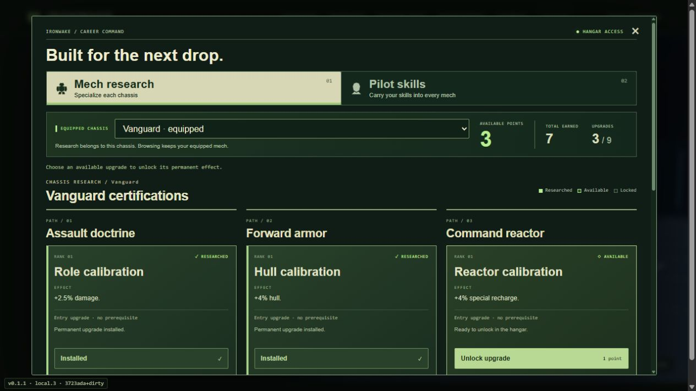
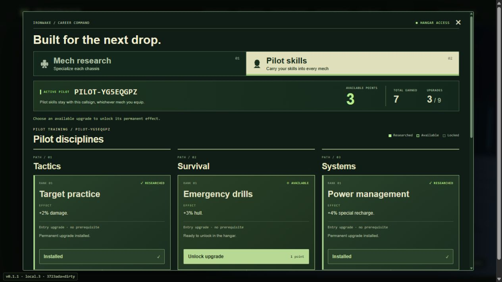
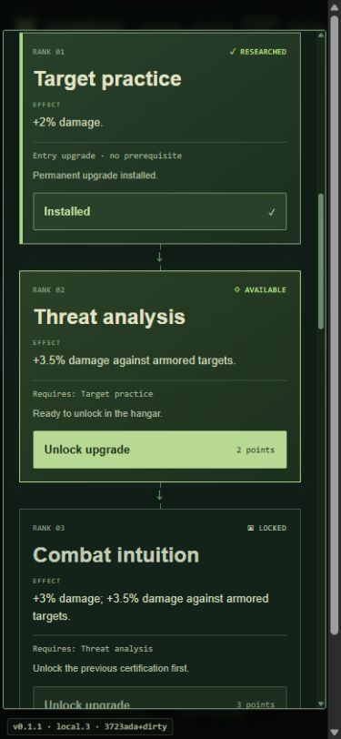

# Persistent mech and pilot upgrade trees

Open **Upgrade trees** in the hangar navigation. Each of the fifteen chassis has three research paths and nine chained upgrades. Legacy custom frames have a separate tree. Pilot training has three disciplines and follows the browser's persistent callsign across chassis, parts and paint. Browsing another chassis's research does not equip it.

Every tree starts with one point. A successful campaign extraction adds one research point to the deployed chassis and one skill point to the local pilot, up to eighteen earned points per tree. Each path costs 1, then 2, then 3 points; the previous node is required. Practice, classic Cinderfall, the target range, duels, withdrawal and defeat award no career points. A free hangar respec refunds the selected tree's spent points. Starting a new campaign preserves career progression.

Progress is local to this browser, under `iw-career-v1`. It is separate from workshop build exports, campaign run modules and salvage. There is no account service or cross-device progression sync. The first pass intentionally offers modest stat bonuses; human playtesting should tune their pace and combinations.

## Boundary with in-mission progression

- `career-progression.js` owns the catalogs, point balances, purchased ranks, reward receipts and sanitizers. `career-view.js` and `career.css` own the hangar UI.
- `cleanBuild` and `mechStats(build)` retain equipment/chassis semantics. Research does not change parts, weight, payload or mount limits.
- `deploymentProgression` sends purchased node IDs as a separate roster `progression: {mech: [], pilot: []}`. The host validates each tree's prerequisites and eighteen-point budget at deployment. Numeric client modifiers are never accepted.
- `combatStats(player)` composes career hull, speed and lift with temporary run modifiers. Mission callbacks use `statsForPlayer(build, player)` so checkpoints, recovery and emergency redeploys preserve the same maximum hull. The HUD uses the same combat stats.
- Outgoing damage, incoming damage, dash recharge, special recharge and passive recovery combine career bonuses with existing field bonuses. Career never adds to or consumes `p.field`, `w.field`, field XP, field input, live offers, items, relays, salvage or refit choices.
- Hangar purchases refresh the separate roster progression and clear that pilot's readiness. Deployment freezes the purchased ranks until return. Rooms use `ironwake-career-v1-` (or `ironwake-demolition-career-v1-`) to isolate incompatible simulations.
- Local career rewards run before host campaign settlement, including on guest result snapshots, and deduplicate by campaign ID and mission level. Guests save their own pilot/chassis points; the host continues to own campaign and run refit validation. Saves remain client-local, without account authentication or anti-cheat guarantees.

The active `feature/field-progression` worktree was inspected without modification. Its integration changes overlap the combat composition functions in `core.js`, plus the mission stat callbacks. Preserve the career layer when incorporating its `combatStats`, then apply its `fieldModifiers`; keep its `p.field` schema and live upgrade paths independent. Neither the campaign save format nor `sortie-progression.js` is changed here.

## Validation

Run `node --test tests/*.test.js` for catalog/save, prerequisites, reward isolation, actual combat composition, roster sanitization and existing game regressions. Run the Cloudflare dry-run build through the project's normal build command.

For manual UI checks, run `node scripts/preview-server.mjs 4186` and open `http://127.0.0.1:4186/ironwake/`. A development-only fixture at `/tests/career-fixtures.html` grants synthetic completed-round research through the reward API for checking deeper paths, respecs and reload persistence. The fixture is outside deployed `dist/` assets.

This implementation passed 297 Node tests and the Wrangler production dry-run build. Browser checks covered chained purchases, locked prerequisites, independent chassis/pilot balances, full respec refunds, keyboard focus, reload and new-campaign persistence, upgraded target-range hull, and the 390px mobile layout. Host/guest reward attribution and replicated combat effects are exercised through serialized snapshot tests; live WAN co-op playtesting remains.

### Captured game UI

Vanguard research with independent Assault, Armor and Reactor paths:

Pilot training carried between mechs:

Stacked pilot prerequisites on a narrow screen:

